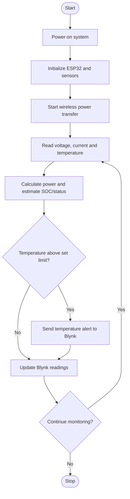

# Smart Wireless EV Charging System

**Department:** Electronics & Computer Science  
**Institute:** St. John College of Engineering & Management, University of Mumbai  
**Academic Year:** 2026–2027  
**Project Guide:** Ms. Vishakha Rane  
**Project Status:** Proposed prototype / under development

## Project Team

| Student | University ID |
|---|---|
| Kanak Marde | EU1237042 |
| Prem Meher | EU2237014 |
| Siddhant Meher | EU2237020 |
| Vedant Pagdhare | EU2237019 |

## Abstract

Electric vehicles are becoming more common, but cable-based charging requires manual plugging and connectors can wear out. This project proposes a low-power wireless charging prototype using magnetic coupling between a transmitter (TX) coil and a receiver (RX) coil, with IoT monitoring.

As described in the synopsis, a 230 V AC supply is converted to 5 V DC by an SMPS adapter. A wireless TX/RX coil module transfers power across an air gap. A boost constant-current/constant-voltage (CC/CV) converter raises and regulates the received output to approximately 14.4 V for a 12 V, 7 Ah sealed lead-acid (SLA) battery. An ESP32, voltage/current monitor, and DS18B20 temperature sensor collect charging measurements and send them to the Blynk mobile dashboard. The planned study also considers coil distance, coil misalignment, temperature rise, and estimated state of charge (SOC).

> This repository describes the proposed design. Add measured results and hardware photos only after they are actually available.

## Objectives

- Design a low-power wireless charging prototype for a 12 V battery.
- Assemble a power path using an AC–DC supply, wireless transmitter/receiver coils, and a CC/CV charging stage.
- Monitor voltage, current, calculated power, and temperature with an ESP32.
- Display charging readings, estimated SOC, and charging/not-charging status in Blynk.
- Investigate how coil distance and lateral misalignment affect transfer performance.
- Observe temperature rise and implement a temperature alert.
- Document testing, risks, sustainability, feasibility, and future scope.

## System Block Diagram


The intended power path is:

```text
230 V AC
   |
   v
5 V DC SMPS Adapter
   |
   v
Wireless Transmitter (TX) Coil
   )))) Magnetic Coupling / Air Gap ((((
Wireless Receiver (RX) Coil
   |
   v
Boost CC/CV Charging Converter
   |
   v
12 V, 7 Ah SLA Battery
```

The monitoring path is:

```text
Voltage / Current Monitor ----+
                              |
DS18B20 Temperature Sensor ---+--> ESP32 --> Wi-Fi --> Blynk Dashboard
                              |
                         SOC estimate,
                         charging status,
                         temperature alert
```

## Data Flow Diagram


1. The power supply energizes the transmitter coil.
2. The receiver coil captures transferred energy.
3. The charging converter regulates the received output for the battery.
4. The voltage/current monitor measures electrical parameters.
5. The DS18B20 measures battery surface temperature.
6. The ESP32 processes readings and sends data over Wi-Fi to Blynk.
7. The dashboard presents voltage, current, power, temperature, estimated SOC, and charging status.

## System Operation Flowchart


Planned operation, based on the synopsis:



The flowchart is a readable Markdown representation of the planned process; the original synopsis diagrams are also included as image files in `images/`.

## Main Components (as specified in the synopsis)

| Component | Synopsis specification / purpose |
|---|---|
| AC–DC SMPS adapter | 230 V AC input, 5 V DC output, 2 A (3 A preferred) |
| Wireless TX/RX module | 5 V DC, 2 A rated, transmitter and receiver coils |
| Fuse with holder | 2 A or 2.5 A DC |
| ON/OFF switch | SPST, 5 V DC, 3 A or higher |
| Boost CC/CV module | Adjustable output up to approximately 14.4 V |
| SLA battery | 12 V, 7 Ah, rechargeable SLA/AGM/VRLA |
| ESP32 development board | Wi-Fi-enabled microcontroller |
| Voltage/current monitor | Synopsis lists INA226 with I²C and 0.1 Ω shunt |
| DS18B20 sensor | Waterproof digital temperature probe |
| 4.7 kΩ resistor | DS18B20 data-line pull-up |
| Wires/connectors | Insulated wires, battery wires, screw terminals/DC connectors |
| Digital multimeter | Electrical measurements and validation |

**Sensor version note:** The original synopsis lists **INA226**. The project discussion later selected **INA219** for the planned build. Update the final component list, wiring, code, and report to match the exact module actually used. Verify the selected module's shunt and current ratings before connecting it.

## Monitoring Parameters

- Battery voltage (V)
- Charging current (A)
- Calculated power (W)
- Battery surface temperature (°C)
- Estimated state of charge (SOC)
- Charging / not-charging status
- Temperature alert when the configured limit is exceeded

The synopsis describes SOC as an estimate based on voltage/current; it is not an exact battery state-of-charge measurement.

## Planned Methodology and Testing

1. Finalize the circuit and verify component ratings.
2. Assemble the low-voltage power-transfer path and coil holder.
3. Add fuse and switch protection.
4. Connect the ESP32 and monitoring sensors.
5. Develop the firmware and configure the Blynk dashboard.
6. Calibrate sensor readings against suitable instruments.
7. Test charging with the coils aligned at different air gaps.
8. Repeat testing with controlled lateral misalignment.
9. Record temperature during operation and check the alert behavior.
10. Document results, limitations, and safety checks.

Efficiency should be calculated only when input and output power are measured consistently:

`Efficiency (%) = (Output Power / Input Power) × 100`

## Work Breakdown Structure

1. **Study and planning:** finalize problem, literature survey, and block diagram.
2. **Hardware:** select/purchase components, assemble power path, coil holder, and enclosure.
3. **Monitoring unit:** connect sensors, program ESP32, calibrate readings, configure Blynk.
4. **Testing:** charging, distance, alignment, temperature, and safety tests.
5. **Documentation:** report, presentation, and demonstration.

## Team Responsibilities (as planned)

| Member | Responsibility |
|---|---|
| Siddhant Meher | ESP32 programming and sensor interfacing |
| Prem Meher | Power circuit assembly |
| Vedant Pagdhare | Blynk dashboard, data logging, and testing |
| Kanak Marde | Literature/documentation and coil holder/enclosure support |

## Budget and Feasibility

The synopsis gives an estimated project budget of approximately **₹3,680**. This is a planning estimate, not a verified final expenditure; update it with actual purchase costs and the final selected sensor module.

The synopsis frames the project as a low-power educational prototype, approximately 5 V / 2 A input and up to around 10 W. It is not intended to charge a full-size road-going EV.

## Risk and Safety Notes

- Keep mains wiring enclosed; use a properly rated, enclosed AC–DC adapter.
- Check polarity, insulation, wiring, and ratings before energizing.
- Use a suitable fuse and switch.
- Do not connect the battery directly to an unregulated receiver output.
- Set the charging voltage and current according to the battery manufacturer's requirements.
- Stop testing if the battery, coils, wires, or converter heats excessively or behaves abnormally.
- Treat the ESP32 temperature alert as supplementary monitoring, not as the only protection.

## Expected Outcomes

The project aims to demonstrate a low-power wireless battery-charging model with IoT monitoring, an ESP32 program, a Blynk dashboard, and recorded observations of efficiency versus distance/misalignment and temperature rise. These are expected outcomes, not claims of completed testing.

## Limitations

- Low-power model; not a full EV charger.
- Charging may be slow because of limited input power.
- SOC is estimated, not exact.
- The air gap is short and coils need near alignment.
- Actual efficiency and thermal performance must be established by testing.

## Future Scope

- Higher-power coils and a purpose-designed high-frequency inverter/rectifier.
- Improved or automatic coil alignment.
- Smart charging-slot booking.
- Solar input integration.
- Battery-health estimation using charging history.

## Sustainability and Applications

The synopsis relates the project to reducing charging-connector wear, improving convenience, and exploring wireless charging for residential parking, public parking, and fleet depots. These are potential applications; the current prototype requires validation before practical deployment.

## Repository Structure

```text
.
├── README.md
├── docs/
│   └── EV Charging System.pdf
├── images/
│   ├── block-diagram.png
│   ├── data-flow-diagram.png
│   └── system-flowchart.png
└── code/
    └── README.md
```

## Firmware

The final ESP32 firmware should be added to `code/` when ready. Do not describe untested or missing code as completed.

## Project Synopsis

The original synopsis is available at [`docs/EV Charging System.pdf`](docs/EV%20Charging%20System.pdf).
